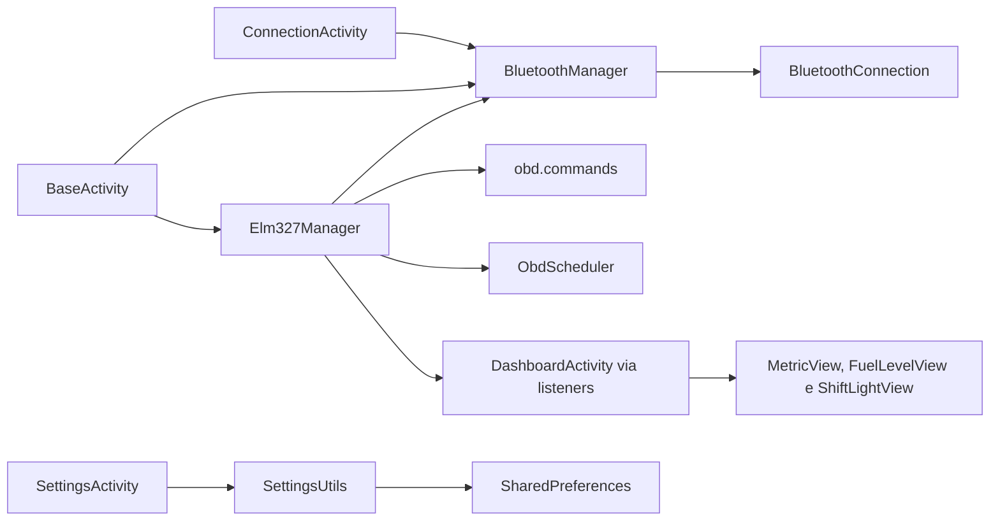

# Arquitetura e mapa do código

Este documento explica como o código de produção está dividido e como seus componentes se relacionam. Os fluxos de usuário, parâmetros OBD e limitações observadas estão em [comportamento atual](current-behavior.md). As regras para alterar ou ampliar essa estrutura estão em [desenvolvimento](development.md).

## Plataforma

O repositório tem um módulo Android, `app`, com recursos Android tradicionais e código de produção Java 11. A configuração efetiva está em `app/build.gradle.kts`: `minSdk` 29, `targetSdk` 36 e `compileSdk` 36.1. Dependências e versões ficam em `gradle/libs.versions.toml`.

## Caminho de dados

A tela de conexão pede ao `BluetoothManager` que abra um dispositivo pareado. O `BluetoothConnection` mantém o transporte serial RFCOMM. O `Elm327Manager` envia comandos AT, consulta os PIDs suportados, agenda leituras e entrega valores por listeners. `DashboardActivity` atualiza as views na thread principal. Configurações de aparência, idioma e RPM usam `SettingsUtils` e preferências privadas do aplicativo.

## Pacotes e pontos de entrada

| Local              | Responsabilidade no código atual                                                                         | Componentes de referência                                                                       |
|--------------------|----------------------------------------------------------------------------------------------------------|-------------------------------------------------------------------------------------------------|
| `ui`               | Telas, navegação e apresentação dos callbacks.                                                           | `BaseActivity`, `SplashActivity`, `ConnectionActivity`, `DashboardActivity`, `SettingsActivity` |
| `bluetooth`        | Adaptador do sistema, dispositivos pareados, estado da sessão, conexão RFCOMM e callbacks de transporte. | `BluetoothManager`, `BluetoothConnection`, listeners e enums de erro                            |
| `elm327`           | Comandos AT, inicialização do adaptador, coordenação da sessão OBD e publicação dos dados.               | `Elm327Manager`, `Elm327Commands`, listeners e enum de erro                                     |
| `obd.commands`     | Montagem de consultas do Modo 01, validação básica e conversão de respostas por PID.                     | `ObdCommand` e comandos tipados                                                                 |
| `obd.scheduler`    | Prontidão por intervalo e ordenação por prioridade de tarefas de PID.                                    | `ObdScheduler`, `PidTask`, `PidPriority`                                                        |
| `model`            | Dados de domínio usados entre telas e transporte.                                                        | `Device`                                                                                        |
| `utils`            | Preferências, diálogos, mensagens breves e funções visuais compartilhadas.                               | `SettingsUtils`, `DialogUtils`, `ToastUtils`, `ViewUtils`                                       |
| `view`             | Componentes customizados do painel.                                                                      | `MetricView`, `FuelLevelView`, `ShiftLightView`                                                 |
| `app/src/main/res` | Layouts, cores, strings, temas, ícones e som de clique.                                                  | `layout/`, `values/`, `drawable/`, `raw/ui_click.wav`                                           |

## Responsabilidades e dependências

- `BluetoothConnection` move bytes e detecta o fim da resposta serial; não converte PIDs.
- `BluetoothManager` mantém o dispositivo e a sessão Bluetooth e expõe operações usadas pela interface e pelo gerenciador ELM327.
- `Elm327Manager` coordena transporte, protocolo do adaptador, ciclo de leitura e listeners; comandos de parsing continuam em `obd.commands`.
- `ObdScheduler` decide quais tarefas estão prontas. Não conhece Activities nem views.
- As Activities conectam ações e exibem estados. As views customizadas desenham métricas, sem implementar o protocolo OBD.
- `SettingsUtils` é o ponto atual de acesso às preferências e de aplicação de tema e idioma.

`BluetoothManager` e `Elm327Manager` são singletons e armazenam o contexto de aplicação, não uma Activity. `BaseActivity` registra listeners e o receiver Bluetooth entre `onStart` e `onStop`, sincroniza o estado Bluetooth ao iniciar e solicita ao `Elm327Manager` que retome uma sessão ainda conectada. Uma Activity que implementa `Elm327ConnectionListener` ou `Elm327DataListener` é registrada automaticamente pela classe base. O ciclo de vida de telas e reconexão está detalhado em [comportamento atual](current-behavior.md).

## Recursos e manifesto

O manifesto, em `app/src/main/AndroidManifest.xml`, define as Activities, orientação e permissões. Layouts, strings, cores, temas, drawables e áudio ficam em `app/src/main/res`. O [guia de desenvolvimento](development.md) é a fonte única das convenções para alterar esses recursos e o código.

## Limites do mapa

A tabela representa o código existente, não uma promessa de que todo adaptador, ECU ou PID é compatível. Consulte [comportamento atual](current-behavior.md) para o que acontece quando há PID não suportado, resposta inválida, permissão ausente ou leitura alternativa de tensão.
