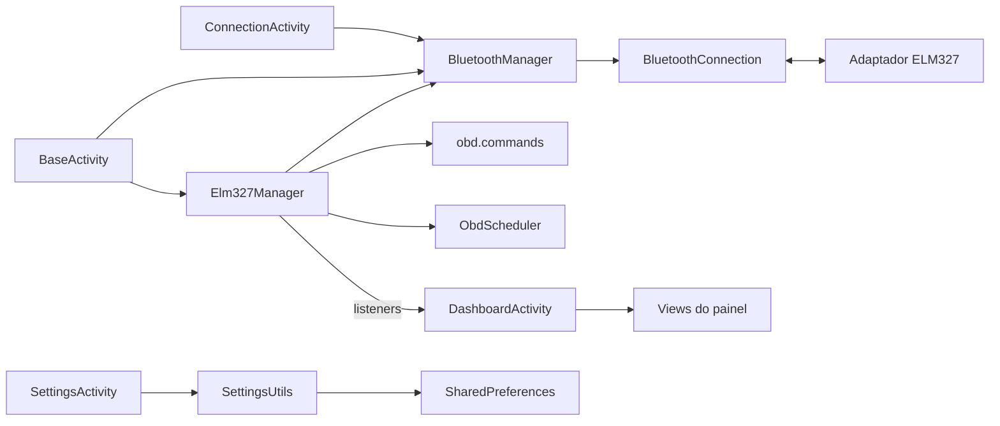

# Arquitetura

Mapa do código de produção e das relações entre componentes. Os fluxos e parâmetros implementados estão em [comportamento atual](current-behavior.md); o ambiente e as convenções estão em [desenvolvimento](development.md).

## Estrutura

O projeto tem um módulo Android, `app`, com código de produção Java e interface baseada em Activities, layouts XML e Views customizadas. Os scripts de build usam Kotlin DSL. O namespace da aplicação é `com.eduardo.obdmonitor`.

Na tabela, os pacotes são relativos a `app/src/main/java/com/eduardo/obdmonitor/`.

| Local              | Responsabilidade                                                                                             | Pontos de entrada                                                                                                                                                                                                                                                                                                                                                                                                                                          |
|--------------------|--------------------------------------------------------------------------------------------------------------|------------------------------------------------------------------------------------------------------------------------------------------------------------------------------------------------------------------------------------------------------------------------------------------------------------------------------------------------------------------------------------------------------------------------------------------------------------|
| `ui`               | Navegação, ações do usuário e apresentação dos estados recebidos.                                            | [BaseActivity](../app/src/main/java/com/eduardo/obdmonitor/ui/BaseActivity.java), [SplashActivity](../app/src/main/java/com/eduardo/obdmonitor/ui/SplashActivity.java), [ConnectionActivity](../app/src/main/java/com/eduardo/obdmonitor/ui/ConnectionActivity.java), [DashboardActivity](../app/src/main/java/com/eduardo/obdmonitor/ui/DashboardActivity.java), [SettingsActivity](../app/src/main/java/com/eduardo/obdmonitor/ui/SettingsActivity.java) |
| `bluetooth`        | Permissões, adaptador Android, pareados, estado da sessão e transporte serial RFCOMM.                        | [BluetoothPermissions](../app/src/main/java/com/eduardo/obdmonitor/bluetooth/BluetoothPermissions.java), [BluetoothManager](../app/src/main/java/com/eduardo/obdmonitor/bluetooth/BluetoothManager.java), [BluetoothConnection](../app/src/main/java/com/eduardo/obdmonitor/bluetooth/BluetoothConnection.java)                                                                                                                                            |
| `elm327`           | Comandos AT, inicialização, descoberta de suporte, coordenação das leituras e publicação de estados e dados. | [Elm327Manager](../app/src/main/java/com/eduardo/obdmonitor/elm327/Elm327Manager.java), [Elm327Commands](../app/src/main/java/com/eduardo/obdmonitor/elm327/Elm327Commands.java), interfaces de listeners e enum de erro                                                                                                                                                                                                                                   |
| `obd.commands`     | Requisições do Serviço 01, extração de bytes, máscaras de suporte e conversões por PID.                      | [ObdCommand](../app/src/main/java/com/eduardo/obdmonitor/obd/commands/ObdCommand.java) e comandos tipados                                                                                                                                                                                                                                                                                                                                                  |
| `obd.scheduler`    | Elegibilidade por suporte e intervalo, ordenação por prioridade e registro de execução.                      | [ObdScheduler](../app/src/main/java/com/eduardo/obdmonitor/obd/scheduler/ObdScheduler.java), [PidTask](../app/src/main/java/com/eduardo/obdmonitor/obd/scheduler/PidTask.java), [PidPriority](../app/src/main/java/com/eduardo/obdmonitor/obd/scheduler/PidPriority.java)                                                                                                                                                                                  |
| `model`            | Representação do dispositivo e de seu estado de conexão.                                                     | [Device](../app/src/main/java/com/eduardo/obdmonitor/model/Device.java)                                                                                                                                                                                                                                                                                                                                                                                    |
| `utils`            | Preferências, tema, idioma, diálogos, mensagens breves e funções visuais compartilhadas.                     | [SettingsUtils](../app/src/main/java/com/eduardo/obdmonitor/utils/SettingsUtils.java), [DialogUtils](../app/src/main/java/com/eduardo/obdmonitor/utils/DialogUtils.java), [ToastUtils](../app/src/main/java/com/eduardo/obdmonitor/utils/ToastUtils.java), [ViewUtils](../app/src/main/java/com/eduardo/obdmonitor/utils/ViewUtils.java)                                                                                                                   |
| `view`             | Desenho e atualização dos componentes do painel.                                                             | [MetricView](../app/src/main/java/com/eduardo/obdmonitor/view/MetricView.java), [FuelLevelView](../app/src/main/java/com/eduardo/obdmonitor/view/FuelLevelView.java), [ShiftLightView](../app/src/main/java/com/eduardo/obdmonitor/view/ShiftLightView.java)                                                                                                                                                                                               |
| `app/src/main/res` | Layouts, textos, temas, cores, ícones e áudio da interface.                                                  | [Recursos Android](../app/src/main/res)                                                                                                                                                                                                                                                                                                                                                                                                                    |

O [manifesto](../app/src/main/AndroidManifest.xml) declara as telas, a Activity de entrada, a orientação e as permissões. As regras para modificar código e recursos pertencem ao guia de desenvolvimento.

## Dependências e caminho dos dados

As setas representam chamadas ou entrega de eventos. O transporte devolve respostas ao gerenciador ELM327, que delega as conversões aos comandos e publica os resultados por listeners. O scheduler seleciona tarefas; a execução das consultas pertence ao `Elm327Manager`.

## Execução e concorrência

- `BluetoothConnection` usa um executor para conectar; `Elm327Manager` usa outro para inicialização e uma thread dedicada para monitoramento. As consultas de um lote são executadas sequencialmente.
- Os callbacks dos gerenciadores não têm garantia geral de execução na thread principal. `BaseActivity` encaminha eventos do Bluetooth à UI, e o painel encaminha seus callbacks ELM327/OBD por `runOnUiThread`.
- O transporte identifica tentativas de conexão; `BluetoothManager` filtra eventos antigos e mantém uma geração da sessão. `Elm327Manager` usa essa geração para reconhecer uma sessão já inicializada.
- No fechamento do transporte, os recursos são limpos sob seu lock e os callbacks de encerramento são publicados após a liberação. Isso evita manter o lock do transporte enquanto o callback aguarda o lock do gerenciador.

## Sessão e ciclo de vida

`BluetoothManager` e `Elm327Manager` são singletons que armazenam contexto de aplicação. A conexão pertence a esses gerenciadores, independentemente de uma instância de Activity; não há serviço Android declarado para monitoramento em segundo plano.

`BaseActivity` registra listeners e solicita o registro do receiver Bluetooth em `onStart`; desfaz ambos em `onStop`. O gerenciador conta os usuários do receiver para compartilhar seu registro entre telas. Activities que implementam `Elm327ConnectionListener` ou `Elm327DataListener` são inscritas automaticamente. Novos listeners de conexão ELM327 recebem o estado conhecido; medições são entregues pelos ciclos de leitura.

Na sincronização inicial, a classe base verifica permissão e rádio, retoma uma sessão Bluetooth existente ou encaminha a ausência de transporte ao gerenciador ELM327. A retirada de listeners não encerra por si só a sessão. A perda de transporte interrompe o monitoramento e limpa os estados de conexão e o suporte das tarefas. Consulte as particularidades dos valores preservados em [comportamento atual](current-behavior.md), tópico **"Validade e indisponibilidade dos dados"**.

`ViewUtils` centraliza o registro dos listeners de clique com som e delega a reprodução a `BaseActivity.playClickSound()`. Os recursos de áudio pertencem à Activity: são preparados em `onCreate` e liberados em `onDestroy`.

`BaseActivity` também aplica configurações ao criar o contexto. A persistência fica em `SettingsUtils`, usando `SharedPreferences`. Consulte as opções e os efeitos na interface em [comportamento atual](current-behavior.md), tópico **"Configurações"**.
