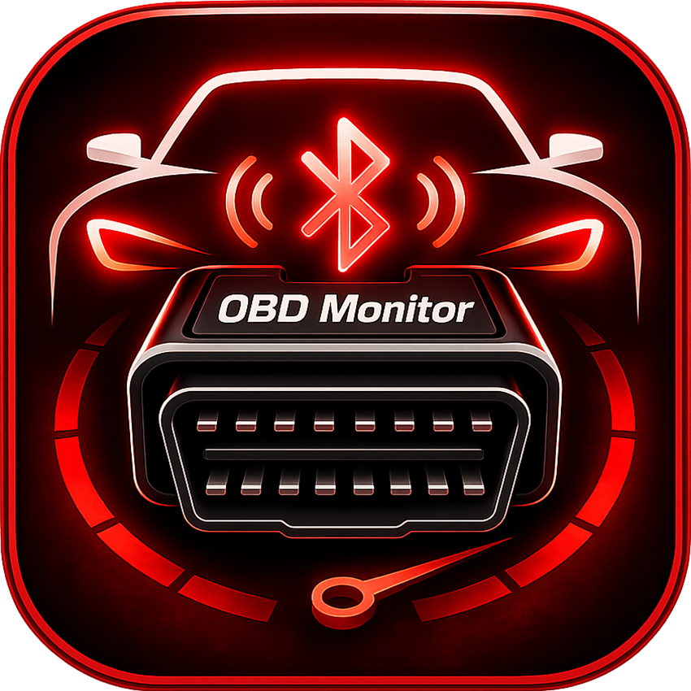

# OBD Monitor

  

  
  
  

---

Aplicativo Android para acompanhar dados atuais do veículo via OBD-II com um adaptador ELM327 por Bluetooth clássico.

Consulte a [documentação do projeto](OBDMonitor/README.md) para usar o aplicativo, preparar o ambiente, entender a arquitetura e executar verificações.
